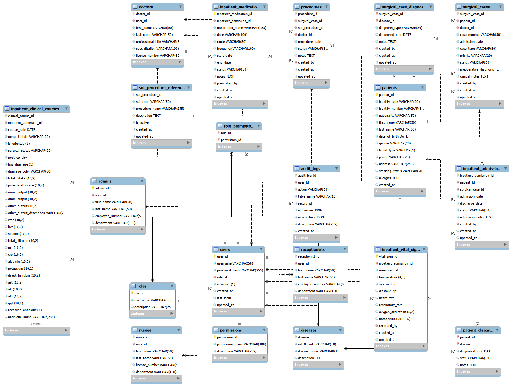

# Hospital Management System (HMS)

A Flask-based Hospital Management System designed to support inpatient clinical information management and General Surgery patient follow-up.

## Database Design

The EER diagram illustrates the relational database structure
designed for the Hospital Management System.

## Technologies

- **Backend:** Python, Flask
- **Database:** MySQL
- **Frontend:** HTML, CSS

## Current Features

- Flask application setup
- MySQL database connectivity
- Relational database schema for hospital and inpatient clinical data
- Database structure for patient admissions, diagnoses, procedures, medications, vital signs, and clinical courses

## Planned Features

- Patient registration and management
- Inpatient admission tracking
- Clinical course and vital signs management
- Diagnosis, procedure, and medication workflows
- CRUD operations
- Role-based access control
- Audit logging

## Project Status

**In development.** The database schema and initial Flask application are in place. The user interface and application workflows are still being developed.

## Local Setup

1. Clone this repository.
2. Create and activate a Python virtual environment.
3. Install the required Python dependencies.
4. Configure the local MySQL database connection.
5. Run the Flask application.

## Disclaimer

This project is intended for educational and portfolio purposes. Use synthetic data only; do not enter real patient information.
